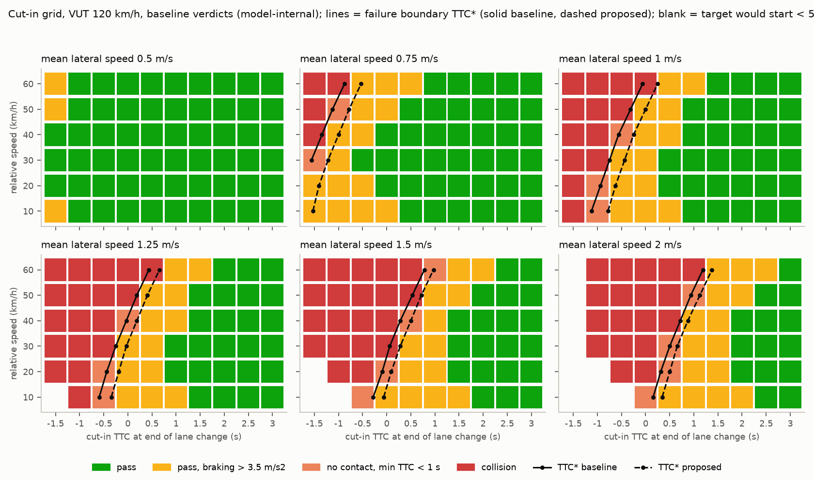
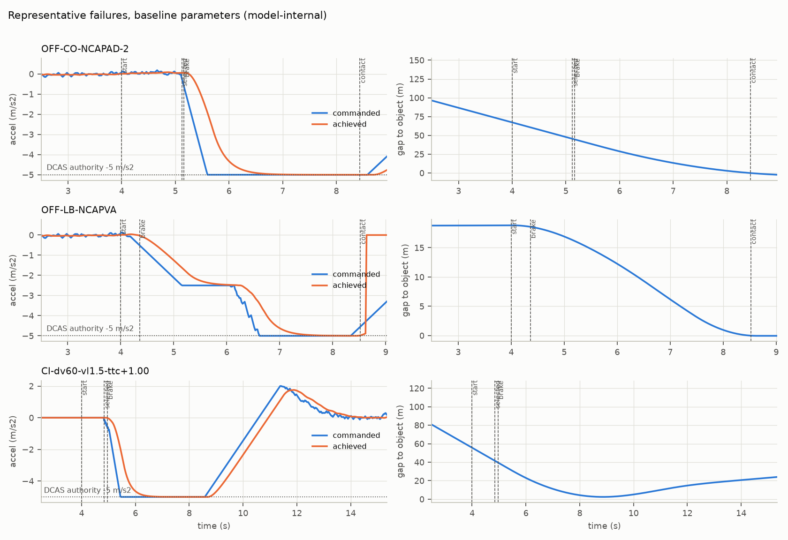
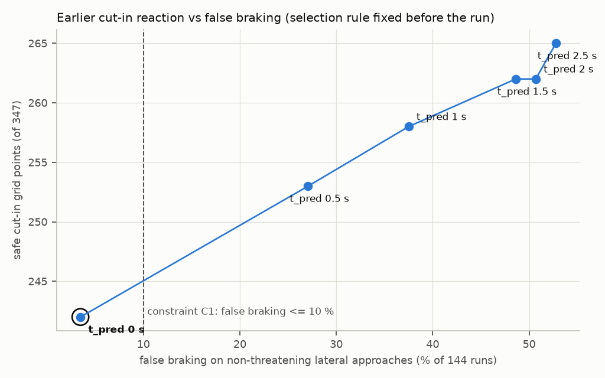

# L2 高速辅助（DCAS）按 UN R171 / Euro NCAP 2026 做闭环验证

作者：罗文杰｜2026-10｜个人项目，使用 AI 工具辅助完成。

> 车辆、执行器、感知、驾驶员都是项目假设的玩具模型，结论只在本模型内成立。本项目**不声称**任何功能符合 UN R171、Euro NCAP 或其他法规。表格由脚本生成（`results/tables.md`），本文只摘录，不手改数字。

## 0 摘要

- **做了什么**：自己写了一个 DCAS 类功能（ACC + 车道居中 + 模式管理 + 驾驶员投入监测），放进 esmini 闭环，按 UN R171 01 系列和 Euro NCAP 2026 辅助驾驶规程测试。驾驶员监测复用 P7 的 DMS 检测器（原样复制、哈希核对）。流程是：官方条款 → 55 条需求 → 参数化场景 → 事先写好的判定 → 切入失效边界（网格 + 二分）→ 根因 → 参数权衡 → 改进后再验证 → 双向追溯。
- **基线结果**：
  - R171 附件 4 的 4 个基础试验（切入 Type 1/2、切出 TTC 3 s、前车 4 m/s² 减速）都安全。
  - Euro NCAP VA 的 CCRb（最近跟车距离）以 2.1 km/h 碰撞。
  - Euro NCAP AD 安全后备的切出 90/70 km/h、TTC 2 s 以 20.7 km/h 碰撞。
  - 切入网格 347 个有效点中 258 个安全、73 个碰撞；前车急减速网格 34 次中 12 次安全。
- **三个根因**（一次只改一处的反事实）：
  1. 前车制动时控制律不看前车减速度，升级到临界制动太晚；
  2. 切出露出的静止车被遮挡、确认延迟，再加执行器滞后，需求超过 DCAS 的 5 m/s² 权限，属于 AEB 的范围；
  3. 弯道限速的规划减速度等于控制器自己的上限，跟踪滞后导致进弯偏快。

  另外，切入网格里“有权限、但反应太慢”的代表点，把感知理想化、去掉执行器滞后或把预测时域加长都能救回来。
- **参数权衡**：切入预测时域 0–2.5 s 共 6 档，选择规则在运行前写进 `scripts/tradeoff.py`。预测越长，网格安全点越多（242 → 265），误制动也越多（5/144 → 76/144）。只有 0 s 满足“误制动 ≤10 %”，因此选中 0 s。
- **改进后**：
  - 前车急减速网格安全次数 12 → 26，CCRb 无碰撞（TTC 2.38 s）；
  - 开弯道限速的越线 1 → 0 次；
  - 非威胁接近的误制动 19/48 → 0/48。

  代价也已写明：切入网格安全点 258 → 242；Euro NCAP AD 的慢速切入（50/10 km/h、TTC −1.5 s）在 DCAS 单独仿真中由安全变为碰撞 14.8 km/h。该点在实车评价中由 ACC 与 AEB 共同完成。
- **驾驶员投入**：EOR 在视线离开后 3.28 s 发出，之后 +2.0 s 升级、再 +4.0 s 发 DCA、升级后 +8.0 s 启动风险减缓停车。R171 的上限分别是 5 / 3 / 5 / 10 s。30 min 内第 3 次升级时锁止。
- **需求检查**：142 条。基线 126 条通过、4 条不通过、12 条为信息；改进后 128 条通过、2 条不通过、12 条为信息。
- **追溯**：`traceability.csv` 共 1637 行，前后向完整（由脚本退出码检查）。

## 1 目标与范围

- **问题**：一个 L2 高速辅助功能，按 R171 和 Euro NCAP 的条款逐条判定能不能过？在切入场景里，失效边界在哪？失效的根本原因是感知、控制律、执行器，还是超出了 DCAS 的职责？调一个参数换来什么，又付出什么？
- **范围**：M1 乘用车，高速公路（R171 2.27 意义上的 Highway），三车道直路和弯道。驾驶员必须手在盘上（不扣留 HOR），没有换道或其他系统发起的机动，没有限速辅助，没有 AEB。

## 2 要求来源与版本判定

### 2.1 读了哪些官方文本

| 文件 | 获取方式 | 用到的内容 |
|---|---|---|
| UN R171，EUR-Lex 合并文本 OJ L 2025/1899（“到 01 系列，生效日期 2025-09-26”；页面注明正式文本为 ECE/TRANS/WP.29/2025/7，按 ECE/TRANS/WP.29/1184 第 64 段修改） | 浏览器读 EUR-Lex HTML；unece.org 对抓取工具返回 403 | 定义 2.x；5.1–5.6；6.1；附件 3 附录 4；附件 4 |
| 联合国条约库保存人通知 C.N.392.2024、C.N.351.2025、C.N.539.2025、C.N.48.2026、C.N.238.2026、C.N.239.2026 | treaties.un.org PDF | 各次修订的约束生效日期 |
| Euro NCAP Assisted Driving – Highway & Interurban Assist Systems Protocol v1.2（2026-07，2026-01 实施） | cdn.euroncap.com PDF（SHA-256 98c2ce70…） | 驾驶员监测前提、锁止、非瞬态状态、安全后备的切入 / 切出 |
| Euro NCAP Safe Driving – Vehicle Assistance Protocol v1.2（2026-07） | cdn.euroncap.com PDF（SHA-256 196583ce…） | ACC 性能：5 m/s² 评价上限、切入 / 切出 / CCRb 参数 |
| Euro NCAP Safe Driving – Driver Engagement Protocol v1.2 | 沿用 P7 已核实的数值（vendor/p7_dms/regulations.py） | 长时分心 3–4 s、VATS 30 s 内 10 s、微睡眠 / 睡眠 / 无响应 |

### 2.2 R171 当前有效的版本

| 修订 | 文件 | 对缔约方有约束力的日期 | 依据 |
|---|---|---|---|
| 原始版本 | — | 2024-09-22 | C.N.392.2024 |
| （00 系列修订） | WP.29/2024/146 | 2025-06-12 | C.N.351.2025 |
| **01 系列** | WP.29/2025/7 | **2025-09-26** | C.N.539.2025 |
| （修订） | WP.29/2025/65 | 2026-01-11 | C.N.48.2026 |
| （修订） | WP.29/2025/143 | 2026-06-04 | C.N.238.2026 |
| 01 系列补充件 1 | WP.29/2025/144 | 2026-06-04 | C.N.239.2026 |
| 02 系列 | WP.29/2026/86 | 据二手来源 2026-06 通过，尚未生效 | 未核实 |

- 本项目以 01 系列合并文本为准。
- 2025/65、2025/143、2025/144 的文本没有读到。二手来源（globalautoregs.com）称后两者增加了 DETA 数据交换附件，2025/143 还删去了对系统发起机动的引用。它们是否改动了本文引用的条款，列入未核实。
- 01 系列已经包含系统发起的机动、扣留 HOR（高速公路、≤130 km/h 时可脱手）和驾驶员不可用响应等内容。本项目的功能不使用前两项。

### 2.3 对设计影响最大的条款

| 条款 | 内容（转述） | 本项目的设计 |
|---|---|---|
| R171 2.16 | 用低于 5 m/s² 的制动需求无法避免的碰撞属于“即将碰撞” | DCAS 纵向权限设为 5 m/s²；超出部分只分类，不靠 DCAS 解决 |
| 5.3.5.1 / 5.3.5.5 | 超出边界：转入 stand-by、立即通知、可控终止；接近边界：提前足够时间告知 | 边界监控 + DCA；弯道预瞄给出“接近边界”提示 |
| 5.3.7.1.2 / 5.3.7.1.2.1 | 申报最大横向加速度 ≤3 m/s²；可超出 ≤0.3 m/s²；≤2 s 可超 40 %，但不超过 3.3；0.5 s 平均横向冲击度 ≤5 m/s³ | 申报 2.5 m/s²，车道居中饱和 2.8，指令变化率 4 m/s³ |
| 5.3.7.1.1.1 | 能按曲率调整车速 | 弯道限速（目标 2.3 m/s²） |
| 5.3.7.1.4 | 到达边界且开始越线：继续尽力转向，光学 + 声 / 触觉警告 | DCA 期间继续横向辅助（10 s） |
| 5.3.7.2.5.1 | （发起机动或扣留 HOR 的系统）须在附件 4 的切出、切入、前车减速场景中避撞 | 本功能不属于此类，但按这三类场景测试 |
| 5.5.3.4.1.x | 制动超越：中止纵向，不另行操作不恢复；加速超越：松开后恢复；转向超越 ≤50 N | 状态机 T03 / T04 / T05 |
| 5.5.4.2.5.2 | **仪表板不算驾驶任务相关区域** | 注视仪表板计为视觉脱离（Euro NCAP DE 把仪表算驾驶任务，两者不同） |
| 5.5.4.2.5.2.1 | 视线回到相关区域 ≥200 ms 才算重新投入 | 0.3 s |
| 5.5.4.2.6.x | HOR：脱手 >5 s（视线在道路时可推迟 ≤5 s），10 s 内升级；EOR：脱离 5 s，3 s 内升级；EOR 升级后 5 s 内 DCA；首次升级或 DCA 后 10 s 内启动不可用响应 | 3.3 / 2.0 / 4.0 / 8.0 s；HOR 4 s（视线在道路时 8 s）、8 s 升级 |
| 5.5.4.2.6.2.2 / 5.5.4.2.5.3 | EOR 确认后 2 s 内再脱离 ≥1 s：立即 EOR；多次短时偏离要有对策 | 两条都实现，后者用 Euro NCAP 的 VATS 规则 |
| 5.3.7.3.1 | 判定不可用后按 R79 04 系列的风险减缓功能安全停车 | 本车道内 2 m/s² 停车（R79 原文未读，数值是假设） |
| 5.5.4.2.8 | 1 次不可用响应 / 2 次 DCA / 30 min 内 3 次升级：禁用 ≥30 min | 本次行程内锁止 |
| 附件 3 附录 4 | 能力须在 ≥90 % 的对应试验中表现出来；按 ≤5 m/s² 与 >5 m/s² 两栏申报 | 官方点各跑 10 个噪声种子；第 9 节整理了一张模型内的能力表 |
| 附件 4 4.2.5.2.4–4.2.5.2.6 | 前车减速：50 km/h、≤4 m/s²；切出：70/50 km/h、TTC 3 s（换道开始时前车对静止车）；切入 Type 1：50/10 km/h、TTC 0 s，Type 2：120/70 km/h、TTC 1.5 s（换道结束时） | 官方点照此设置 |
| Euro NCAP AD 2.3.2 | DSM 不能工作时 ≤10 s 退出；分心阈值放宽 ≤150 %；30 min 内 [3] 次后锁止（加分） | 5 s 退出；3.3 s（≤4.5 s）；锁止 |
| Euro NCAP AD 4.2 / 4.3.1 | 微睡眠 / 睡眠：报警并加大时距；无响应：保持转向停车；安全后备：切入 TTC −1.5 / 0.5 s，切出 TTC 2 s | 时距 +0.6 s；风险减缓停车；官方点 |
| Euro NCAP VA 第 2 章 | ACC 只在 ≤5 m/s²（500 ms 滑动平均 +10 %）范围内评价 | 判定准则 FAIL_DECEL 的阈值 5.5 m/s² |

### 2.4 需求注册表

- `dcas/requirements.py`，导出为 `requirements.csv`，共 55 条：R171 43 条、Euro NCAP 10 条、项目设计目标 2 条。
- 每条写明来源文件、条款号、类型和验证方式。
- 5 条写明不在本项目验证的理由：
  - R171-GEN-03 / GEN-04：整车需装 AEB、LDW；DCAS 不得抑制 AEB。没有 AEB 模型，AEB 本身见 P5；
  - R171-ENG-13：视觉判定不可用时不得离开本车道。本功能没有会离开车道的机动，由功能范围满足；
  - R171-MAN-01：换道和系统发起的机动不在范围内；
  - R171-SPD-01：限速辅助，没有限速数据。

## 3 方法

### 3.1 闭环

```
esmini（OpenSCENARIO，固定步长 20 ms；本车由 ExternalController 接管，其他车按 storyboard）
  └─ 目标真值 → 目标列表模型（视场、遮挡、3 帧确认、100 ms 时延、噪声、横向卡尔曼滤波）
       └─ ACC（目标选择 + 定时距跟车 + 弯道限速）     车道居中（曲率前馈 + 反馈，限幅）
       └─ 边界监控      驾驶员投入监测（P7 检测器 + R171 升级）      脚本化驾驶员（视线、手、踏板、按键）
            └─ 模式管理（6 个状态、15 个转换）→ 谁控制纵向 / 横向
                 └─ 本车模型（纵向：纯延迟 0.1 s + 一阶 0.25 s；横向：运动学单轨 + 0.15 s 转向滞后）
                      └─ SE_ReportObjectRoadPos（车道 -2 内的横向偏移、s）+ SE_ReportObjectSpeed → esmini
```

- esmini v3.10.2 通过 `esminiLib.dll`（ctypes）运行。esmini 打不开含中文的绝对路径，所以以 `scenarios/` 为工作目录、用相对路径调用（同 P5）。
- **esmini 语义先用探针测出**，再在纯 Python 后端里复现（`dcas/backends.py`）：
  - 正弦换道的横向位置为 t0 + Δ·(1 − cos πx)/2，x = (时刻 − 开始) / 时长，误差 5×10⁻⁵ m；
  - 换道中纵向按 v·cos h 前进，h 取上一步的横向位移；
  - 制动时先更新速度、再积分位置。

  本车道中心的曲率：esmini 查询（look-ahead 模式 0）与 `dcas/road.py` 的 κ/(1 − κt) 一致，单元测试要求差 <10⁻⁶。
- **同一份几何**：OpenDRIVE 由 `dcas/road.py` 生成，控制器的曲率预瞄也用它。R171 附件 4 4.2.4.1 的 S 弯按表中回旋线参数生成，A²/L 与圆弧半径的误差 <0.2 %（单元测试）。

### 3.2 功能设计（参数见 `dcas/params.py` 与 `results/parameters.csv`；设计假设 DA-01…DA-28）

- **ACC**：
  - 跟车律为 a = 0.25·clip(间距误差, ±8 m) + 0.80·相对速度，限制在舒适范围内（≥ −2.5 m/s²）。
  - 接近时至少按运动学需求 v_rel² / (2(gap − 5 m)) 的 1.25 倍制动。1.25 倍需求超过舒适限值时进入临界模式：权限 5 m/s²，冲击度 10 m/s³。
  - 多个路径内目标取最严；加速上限 2 m/s²，舒适冲击度 2.5 m/s³。
- **切入判定**（权衡参数）：
  - 目标近侧车身侵入本车道 ≥0.3 m 即为路径内目标；
  - 横向速度朝本车道 ≥0.2 m/s 时，用预测时域 t_pred 外推侵入量；
  - 侵入量 <0.05 m 时释放（切出）。
- **车道居中**：
  - 闭环自然频率 0.9 rad/s、阻尼 0.9，曲率前馈预瞄 0.3 s；
  - 横向加速度饱和 2.8 m/s²，指令变化率 4 m/s³。
- **弯道限速**：沿预瞄求 v ≤ √(2.3/κ)，并要求能以规划减速度到达。
- **边界监控**：
  - 车道线丢失 >0.5 s；
  - 车道居中饱和且偏移 >0.5 m；
  - 超出设计车速；
  - DMS 不可用 5 s；
  - 安全带解开；
  - 锁止。
- **驾驶员投入**：见 2.3 节的时序。视觉相关区域是道路和后视镜；P7 的 LongGlance 负责计时，容差 0.3 s 即重新投入时间，“unknown” 冻结计时。

**模式转换**（`dcas/state_machine.py`）：

| 编号 | 转换 | 条件 | 依据 |
|---|---|---|---|
| T01 | OFF → STANDBY | 主开关（驾驶员有意操作） | R171 5.5.3.2.2 |
| T02 | STANDBY → ACTIVE | 设定键且前提全部满足 | 5.5.3.2.3 |
| T03 | ACTIVE → STANDBY | 踩制动或按取消 | 5.5.3.4.1.1 |
| T04 / T05 | ACTIVE ↔ DRIVER_OVERRIDE | 加速踏板 / 转向扭矩超越，结束后恢复 | 5.5.3.4.1.3 / .4 |
| T06 | → TAKEOVER_REQUEST | 脱离报警升级到 DCA | 5.5.4.2.6.3.1 |
| T07 | → TAKEOVER_REQUEST | 到达系统边界 | 5.3.5.1、5.3.7.1.4 |
| T08 | TAKEOVER_REQUEST → STANDBY | 驾驶员接管 | 5.5.4.2.3.3.2 |
| T09 | TAKEOVER_REQUEST → MRM | 不可用 / 8 s 无人接管 | 5.5.4.2.6.4.1、5.3.7.3.1 |
| T10 | ACTIVE → MRM | 闭眼 ≥6 s 判定无响应 | Euro NCAP AD 4.2.3 |
| T11 / T12 | MRM → STANDBY / 保持 | 驾驶员接管 / 停车后保持 | 设计（R79 未核实） |
| T13 / T14 | → OFF | 主开关关闭 / 整体失效（并给出失效警告） | 5.5.3.3.1 / 5.4.2.1 |
| T15 | 激活被拒 | 锁止或前提不满足，给出提示 | 5.5.4.2.8.1、5.4.5 |

### 3.3 判定准则（第一次批量运行前写入 `dcas/evaluate.py`）

- **纵向场景**，依次判定：
  - 碰撞 → FAIL_COLLISION；
  - 路径内目标最小 TTC <1.0 s → FAIL_TTC；
  - 500 ms 平均减速度 >5.5 m/s²（Euro NCAP VA 的 5 m/s² + 10 %）→ FAIL_DECEL；
  - 横向偏移 >0.5 m → FAIL_LATERAL；
  - 安全但 500 ms 减速度 >3.5 m/s² → PASS_HARSH（R171 5.3.7.2.5.2 “不急刹”，5.3.6.3.1 允许为安全所需的更大减速度）；
  - 其余为 PASS。

  失效边界取“安全 = PASS 或 PASS_HARSH”。
- **弯道**：
  - 系统转向期间超出 5.3.7.1.2 / 5.3.7.1.2.1 的限值 → 不通过；
  - 偏移 >0.5 m 或越线，但横向边界 DCA 不晚于越线 → BOUNDARY_HANDLED；
  - 否则不通过。
- **误制动**：探测车作为 ACC 目标时指令减速度 ≥1.0 m/s²，或速度损失 ≥3 km/h。
- `run_all.py` 记录 evaluate.py 的 SHA-256，基线与改进两次都是 05c0735f0540…，说明准则在两批运行之间没有改动。

### 3.4 可信度检查

| 检查 | 结果 |
|---|---|
| esmini 与纯 Python 后端（78 个抽查用例 × 2 套参数） | 状态序列 78/78、判定 78/78 一致；最小间距最大差 0.0535 m（基线）/ 0.0314 m（改进）；esmini 碰撞标志与几何判定 78/78 一致 |
| 步长 20 ms 对 10 ms（13 个官方纵向点） | 判定一致 11/13；不一致的 2 个都贴在阈值上：Euro NCAP AD 切入 −1.5 s 的最小 TTC 1.038 → 0.966 s；CCRb 由 2.06 km/h 碰撞变为不碰撞、最小 TTC 0.104 s。峰值减速度最大差 0.174 m/s²，碰撞速度最大差 2.38 km/h |
| 噪声鲁棒性（官方点 × 10 个种子，R171 附件 3 附录 4 的 90 %） | 见 `results/tables.md` 表 15：基线中 OFF-CI-NCAPAD-1 为 8/10、两个碰撞点为 0/10，其余 10/10 |
| 单元测试 | pytest 27 项通过（没有 esmini 时 25 项通过、2 项跳过） |
| 复用代码 | `vendor/p7_dms` 的 5 个文件与 P7 逐字节一致（`scripts/check_vendor.py`） |

## 4 场景

| 族 | 文件 | 参数 | 用例 |
|---|---|---|---|
| 切入 | CutIn.xosc | 本车 / 目标车速、换道开始与时长、目标车道 | 官方 6 点；网格 TTC 10 档（−1.5…3.0 s）× 平均横向速度 6 档（0.5…2.0 m/s）× 相对速度 6 档（10…60 km/h），本车 120 km/h；二分点 232 个 |
| 切出 | CutOut.xosc | 前车车速、静止车位置、切出开始与时长 | 官方 5 点；网格：车速 70/50、90/70、120/100 × TTC 1.5…3.5 s × 时距 1.0 / 1.8 s |
| 前车减速 | LeadBrake.xosc | 车速、减速度、开始时刻 | 官方 2 点；网格：50/80/100/120 km/h × 2/4/6/8 m/s² × 时距 1.0 / 1.8 s |
| 非威胁接近 | LatProbe.xosc | 横向偏移、横移时长、保持后返回 | 偏移 0.4…1.0 m × 时长 1 / 2 s × 间距 10 / 20 / 35 m × 相对速度 10 / 30 km/h，共 48 例 |
| 弯道 | Curve_R250/R374/R500、SBend | 车速 | 80…130 km/h × 弯道限速开 / 关，加 R171 附件 4 的 3 个官方点 |
| 驾驶员投入 / 功能 | Highway.xosc | 前车位置和车速 | 13 条驾驶员时间线、9 个功能用例（超越、边界、失效、主开关、稳态跟车） |

- **TTC 定义**：切入按 R171 附件 4 4.2.5.2.6.1.2，取目标换道结束（后部中心到达本车道中央）时的开环 TTC；切出按 4.2.5.2.5.1.2，取前车开始换道时对静止车的 TTC。esmini 换道时目标的纵向前进略有减少，已在初始间距里补偿（单元测试 `test_cutin_ttc_definition`，误差 ≤0.03 s）。
- **切入网格**：13 个组合因换道开始时目标领先本车不足 5 m（会变成并排切入）没有进入网格（`results/cutin_invalid.csv`）。
- **轨迹形状**：目标换道用 esmini 的正弦横向轨迹，不是法规写的两段等半径圆弧。时长按法规的换道长度换算（例如 Type 2：60 m ÷ 70 km/h = 3.09 s），峰值横向加速度不同。
- **数量**：全部用例都写成 OpenSCENARIO ParameterValueDistribution（13 个网格文件，775 个用例），两个后端读同一份参数。

## 5 结果

### 表 0（节选）  各套件汇总

| 套件 | 基线 | 改进 |
|---|---|---|
| 切入官方点 | 安全 6/6，碰撞 0 | 安全 5/6，碰撞 1 |
| 切入网格 | 安全 258/347，碰撞 73 | 安全 242/347，碰撞 86 |
| 切出（含官方点） | 安全 25/35，碰撞 9 | 安全 25/35，碰撞 9 |
| 前车急减速（含官方点） | 安全 12/34，碰撞 21 | 安全 26/34，碰撞 7 |
| 弯道 | 通过 43，到达边界已 DCA 8，不通过 0（共 51） | 通过 44，到达边界已 DCA 7，不通过 0（共 51） |
| 非威胁横向接近（种子 0） | 误制动 19/48 | 误制动 0/48 |

### 表 1  官方试验点（DCAS 单独，纵向权限 5 m/s²）

| 用例 | 依据 | 基线 | 改进 |
|---|---|---|---|
| OFF-CI-R171-T1 | R171 附件 4 切入 Type 1 | 通过；TTC 2.38 s；2.93 m/s² | 通过；TTC 2.19 s；3.29 m/s² |
| OFF-CI-R171-T2 | R171 附件 4 切入 Type 2 | 通过；TTC 2.49 s；3.16 m/s² | 通过·重制动；TTC 2.30 s；3.54 m/s² |
| OFF-CI-NCAPVA-1 / -2 | Euro NCAP VA 切入 TTC 0.0 / 1.5 | 通过 / 通过 | 通过 / 通过·重制动 |
| OFF-CI-NCAPAD-1 | Euro NCAP AD 切入 TTC −1.5 | 通过·重制动；TTC 1.04 s；5.00 m/s² | 碰撞 14.8 km/h |
| OFF-CI-NCAPAD-2 | Euro NCAP AD 切入 TTC 0.5 | 通过·重制动；TTC 1.60 s | 通过·重制动；TTC 1.03 s |
| OFF-CO-R171 | R171 附件 4 切出 | 通过；TTC 2.52 s；3.15 m/s² | 同左 |
| OFF-CO-NCAPVA-2 | Euro NCAP VA 切出 90/70 | 通过·重制动；TTC 2.20 s；4.59 m/s² | 同左 |
| OFF-CO-NCAPAD-1 | Euro NCAP AD 切出 70/50、TTC 2.0 | 通过·重制动；TTC 1.69 s；4.96 m/s² | 同左 |
| OFF-CO-NCAPAD-2 | Euro NCAP AD 切出 90/70、TTC 2.0 | 碰撞 20.7 km/h | 碰撞 20.7 km/h |
| OFF-LB-R171 | R171 附件 4 前车减速（默认时距） | 通过·重制动；TTC 1.71 s；4.25 m/s² | 通过；TTC 2.45 s；3.14 m/s² |
| OFF-LB-NCAPVA | Euro NCAP VA CCRb（最近时距） | 碰撞 2.1 km/h | 通过·重制动；TTC 2.38 s；4.41 m/s² |
| OFF-CV-R171-BASE | 附件 4 4.2.5.1.1.1.1（申报值 85 %，恒速） | 通过；a_y 2.14 m/s²；偏移 0.11 m | 同左 |
| OFF-CV-R171-PROVOKE | 4.2.5.1.1.1.2（> 申报值 + 0.3） | 通过；降到 106.3 km/h；a_y 2.65 m/s² | 通过；a_y 2.56 m/s² |
| OFF-CV-R171-PROVOKE-nocsa | 同上，关闭弯道限速 | 到达边界·已 DCA；系统 a_y 2.80 m/s² | 同左 |

完整对比见 `results/tables.md` 表 1。Euro NCAP AD 安全后备项在实车上是 ACC 与 AEB 一起评价的，这里只是 DCAS 单独的结果。

### 5.1 车道居中与弯道（`results/tables.md` 表 7）

- **限值**：51 次运行中，系统产生的横向加速度峰值 2.80 m/s²，超过申报值 + 0.3 的最长连续时间 0.00 s，0.5 s 平均横向冲击度峰值 3.92 m/s³，都在 R171 限值内（R171-LAT-02 / LAT-03）。
- **所需横向加速度 ≤ 申报值 2.5 m/s² 的弯道**：全部不越线。
- **弯道限速开**：所需超过目标值时降速。例如 R374、120 km/h（所需 2.93 m/s²）降到 106.3 km/h，系统峰值 2.61 m/s²。
- **弯道限速关**：到达横向边界，DCA 都早于越线（BOUNDARY_HANDLED）。“接近边界”提示比 DCA 早 6.36–8.22 s（R171-BND-02，设计目标 ≥3 s）。

  但车辆仍会越线：驾驶员模型在 DCA 后 1.0 s 接管，这段时间里已经越过车道线。这说明对限速关闭的变体，DCA 应在“接近边界”时就发出，而不是等到饱和且偏移 0.5 m（列为建议）。
- **R250、130 km/h（所需 5.11 m/s²）**：基线开着弯道限速仍越线，见根因 3。

### 5.2 驾驶员投入（`results/tables.md` 表 8，分心从 10.0 s 开始）

| 用例 | 事件时刻 s | 与 R171 上限对比 |
|---|---|---|
| EG-03 手机 4 s | EOR 13.28；回到道路后 0.3 s 确认 | EOR 3.28 s ≤5 s；重新投入 0.3 s ≥0.2 s |
| EG-02 仪表板 4 s | EOR 13.28 | 仪表板计为脱离（R171 5.5.4.2.5.2）；按 Euro NCAP DE 的口径它属于驾驶任务，不会报警 |
| EG-04 每 3 s 看 2.4 s 手机 | EOR 22.38（VATS 触发） | 每次注视都不到 3.3 s 阈值，靠多次短时偏离对策发出 EOR |
| EG-05 确认后再看手机 | 间隔 0.30 s 后再次脱离，0.98 s 时立即 EOR | R171：≥1 s 立即发出，通过 |
| EG-06 一直看手机、不回应 | EOR 13.28 → 升级 15.28 → DCA 19.28 → 风险减缓 23.28 → 40.76 停车 | 2.0 s ≤3 s；4.0 s ≤5 s；升级后 8.0 s ≤10 s；随后锁止 |
| EG-08 脱手、视线在道路 | HOR 17.98（推迟到 8 s）→ 升级 25.98 → DCA 29.98 → 风险减缓 33.98 | 8 s ≤10 s；8 s ≤10 s；8 s ≤10 s |
| EG-10 闭眼 | 微睡眠后时距 +0.6 s；睡眠 3 s 时 DCA（12.98）；6 s 时风险减缓（15.98） | Euro NCAP AD 4.2.1–4.2.3 |
| EG-12 三次分心，每次升级后回到道路 | 第 3 次升级（75.28）时锁止，之后的激活被拒 | R171 5.5.4.2.8.2 (c)；Euro NCAP AD 锁止 |
| EG-13 摄像头遮挡 20 s | 5 s 后 DCA（14.98），遮挡期间激活被拒 | Euro NCAP AD ≤10 s |

### 5.3 需求检查

`results/checks.csv` 共 142 条。基线 126 条通过、4 条不通过、12 条为信息；改进后 128 条通过、2 条不通过、12 条为信息。

- **基线的 4 条不通过**：
  - R171-LAT-04：R250、130 km/h 开弯道限速仍越线；
  - R171-VAL-01（噪声种子 ≥90 %）× 3：Euro NCAP AD 切入 −1.5 s（8/10）、切出 90/70 TTC 2 s（0/10）、Euro NCAP VA CCRb（0/10）。
- **改进后的 2 条不通过**：都是 R171-VAL-01，Euro NCAP AD 切入 −1.5 s（0/10）和切出 90/70 TTC 2 s（0/10）。
- **信息项**：列出“安全但 >3.5 m/s²”和“超出 DCAS 权限”的计数，法规没有给阈值。

## 6 切入失效边界

**方法**（写在 `scripts/boundary_search.py` 文件头，运行前固定）：

1. 先跑 347 点网格；
2. 对每一对（相对速度，横向速度），在最高的不安全 TTC 与其上方第一个安全 TTC 之间二分 4 次（0.5 s → 约 0.03 s）；
3. 安全的一端即为 TTC*。

36 对中，基线有 28 对需要二分（新增 112 次运行），改进有 30 对（120 次）。两套参数都没有出现非单调的组合。

### 表 4  TTC*（s，基线 / 改进；TTC 高于 TTC* 全部安全）

| 相对速度 km/h ＼ 平均横向速度 m/s | 0.5 | 0.75 | 1 | 1.25 | 1.5 | 2 |
|---|---|---|---|---|---|---|
| 10 | <-1.5 / <-1.5 | <-1.5 / -1.28 | -0.88 / -0.53 | -0.34 / -0.09 | -0.03 / +0.19 | +0.41 / +0.59 |
| 20 | <-1.5 / <-1.5 | <-1.5 / -1.16 | -0.69 / -0.38 | -0.19 / +0.06 | +0.16 / +0.34 | +0.56 / +0.75 |
| 30 | <-1.5 / <-1.5 | -1.31 / -0.97 | -0.50 / -0.19 | +0.00 / +0.22 | +0.31 / +0.53 | +0.75 / +0.91 |
| 40 | <-1.5 / <-1.5 | -1.09 / -0.75 | -0.31 / +0.00 | +0.22 / +0.44 | +0.53 / +0.75 | +0.97 / +1.12 |
| 50 | <-1.5 / <-1.5 | -0.88 / -0.53 | -0.06 / +0.25 | +0.44 / +0.66 | +0.78 / +0.97 | +1.19 / +1.38 |
| 60 | <-1.5 / <-1.5 | -0.62 / -0.28 | +0.19 / +0.50 | +0.69 / +0.91 | +1.03 / +1.22 | +1.44 / +1.62 |



- **趋势**：横向速度越快、相对速度越大，边界越高。横向速度 2 m/s、相对速度 60 km/h 时，换道结束时 TTC 要 ≥1.44 s；横向速度 0.5 m/s 时整列都安全，因为慢速切入留给系统的时间长。
- **余量**：R171 Type 2（相对 50 km/h、平均横向速度约 1.13 m/s、TTC 1.5 s）位于相邻两列的边界（−0.06 s 与 +0.44 s）之上。Euro NCAP AD 的 TTC 0.5 s（同样的速度组合）已接近边界，改进参数下最小 TTC 只有 1.03 s。
- **改进参数**：两套参数都二分到的 28 个组合中，改进参数的 TTC* 比基线高 0.16–0.34 s，这是把预测时域从 1.0 s 改为 0 s 的代价（第 8 节）。

### 表 3  不安全运行的分类

| 参数 | 不安全 | 选中时运动学需求已 >5 m/s²（超出 DCAS 权限，R171 2.16） | 选中时 ≤5 m/s²（反应链太慢） | 从未选中 |
|---|---|---|---|---|
| 基线 | 89 | 31 | 53 | 5 |
| 改进 | 105 | 39 | 54 | 12 |

“从未选中”的都是负 TTC、快速横移的组合：目标进入本车道时已与本车并排，车身侧面接触，纵向控制无能为力。

## 7 根因分析

**选点规则**（写在 `scripts/root_cause.py`）：

- 基线下不安全的全部官方纵向点；
- 开着弯道限速仍越线的弯道运行；
- 切入网格中，选中时运动学需求 ≤5 m/s²（有权限）但仍不安全、TTC 最高的一点。

第一遍没有找到不安全的官方切入点，所以最后一类是后来补充的。每个点一次只改一处，重跑。

### 表 10  一次只改一处的反事实（碰撞后为相对碰撞速度 km/h，括号内为最小 TTC s）

| 用例 | 基线 | 感知理想化 | 无执行器滞后 | 考虑前车减速度 | 预测 2 s | 权限 9 m/s² | 规划减速度 1.0 |
|---|---|---|---|---|---|---|---|
| OFF-CO-NCAPAD-2 | 碰撞 20.7 | 碰撞 4.8 | TTC<1 s (0.97) | 碰撞 20.7 | 碰撞 20.7 | 减速度超限 (1.44) | 碰撞 20.7 |
| OFF-LB-NCAPVA | 碰撞 2.1 | TTC<1 s (0.64) | 通过·重制动 (1.01) | 通过·重制动 (2.38) | 碰撞 2.1 | TTC<1 s (0.82) | 碰撞 2.1 |
| CV-R250-v130-csa | 到达边界·已 DCA | 同左 | 同左 | 同左 | 同左 | 同左 | 通过 |
| CI-dv60-vl1.5-ttc+1.00 | TTC<1 s (0.99) | 通过·重制动 (1.85) | 通过·重制动 (1.71) | TTC<1 s (0.99) | 通过·重制动 (1.24) | 减速度超限 (1.56) | TTC<1 s (0.99) |

### 表 11  关键时刻（s）

| 用例 | 机动开始 | 压线 | 侵入 0.3 m | 航迹确认 | 选为目标 | 开始制动 | 选中时运动学需求 m/s² | 碰撞 | 接近边界提示 | 横向 DCA | 越线 |
|---|---|---|---|---|---|---|---|---|---|---|---|
| OFF-CO-NCAPAD-2 | 4.00 | - | - | 静止车 5.12 | 5.12 | 5.16 | 4.03 | 8.44 | - | - | - |
| OFF-LB-NCAPVA | 4.00 | - | - | 前车 0.2 | 0.2 | 4.36 | 0.00 | 8.52 | - | - | - |
| CV-R250-v130-csa | - | - | - | - | - | 5.4 | - | - | 6.2 | 13.6 | 14.78 |
| CI-dv60-vl1.5-ttc+1.00 | 4.00 | 4.765 | 4.907 | 目标 0.2 | 4.84 | 4.96 | 3.22 | - | - | - | - |



**根因 1：前车制动时，控制律不看前车减速度（OFF-LB-NCAPVA，Euro NCAP VA CCRb，最近时距 1.0 s）**
- **现象**：前车 4.00 s 开始以 4 m/s² 制动。本车 4.36 s 开始制动，但指令在 −2.5 m/s²（舒适限值）停了约 1 s（时间序列 `RC-OFF-LB-NCAPVA.csv` 中 5.16–6.14 s）；直到“1.25 × 运动学需求”超过舒适限值才升级到 5 m/s²，最终以 2.1 km/h 碰撞。
- **原因**：运动学需求按“前车匀速”计算。前车刚开始减速时相对速度还小，需求被低估，而前车停车所需的距离被忽略了。
- **证据**：感知理想化救不回来（最小 TTC 0.64 s），说明不是感知问题。加入前车减速度项（用目标速度的滤波差分估计）后为 TTC 2.38 s。去掉执行器滞后也能勉强救回（1.01 s），说明滞后是放大因素。
- **修正**：在运动学需求里加入“前车停车距离”项（`lead_accel_ff`，阈值 −1.5 m/s²）。前车急减速网格的安全次数从 12 增到 26（表 0）。

**根因 2：切出露出静止车时，遮挡与确认用掉了时间，需求超出 DCAS 权限（OFF-CO-NCAPAD-2，90/70 km/h，TTC 2 s）**
- **现象**：前车 4.00 s 开始切出，静止车 5.12 s 才被确认并选为目标，此时运动学需求已是 4.03 m/s²。考虑执行器滞后和 1.25 倍余量后，需求超过 5 m/s²，最终以 20.7 km/h 碰撞。
- **证据**：
  - 感知理想化：碰撞速度降到 4.8 km/h；
  - 无执行器滞后：TTC 0.97 s，不碰撞但余量不够；
  - 只有权限 9 m/s² 能避撞（最小 TTC 1.44 s），但 500 ms 减速度超过 5.5 m/s²；
  - 加长切入预测时域无效，因为问题出在静止车被遮挡，而不在切入判断。
- **结论**：这类场景超出了 DCAS 的职责（R171 2.16：需要 >5 m/s² 即为即将碰撞），应由 AEB 处理。Euro NCAP AD 的安全后备项本来就是按 ACC + AEB 合并评价的。不应为了过这个点去提高 DCAS 的权限或缩短确认时间（后者会增加幻影目标误制动，P5 已有类似结论）。

**根因 3：弯道限速规划没有给跟踪滞后留余量（CV-R250-v130-csa）**
- **现象**：5.4 s 开始为弯道减速，6.2 s 给出“接近边界”提示。速度跟踪是比例控制（增益 0.4/s，减速上限 1.5 m/s²），而规划也用 1.5 m/s²，实际速度一直落后于规划曲线。进弯时车速偏高，横向饱和后偏移超过 0.5 m，13.6 s 发 DCA，14.78 s 越线。
- **证据与修正**：只把规划减速度改为 1.0 m/s²（`a_curve_plan`），该点不再越线，最大偏移 0.17 m（表 7 改进列）。其他弯道运行不受影响。

**代表性的切入失效：有权限但反应链太慢（CI-dv60-vl1.5-ttc+1.00）**
- **时间线**：目标 4.765 s 压线，4.84 s 被选中（预测时域 1 s 让它早于 0.3 m 侵入的 4.907 s 被选中），4.96 s 开始制动。选中时需求只有 3.22 m/s²，但制动建立（冲击度限制 + 0.1 s 纯延迟 + 0.25 s 时间常数）期间间距继续缩小，最小 TTC 0.99 s，差 0.01 s 没达到 1.0 s 的准则。
- **证据**：感知理想化（1.85 s）、无执行器滞后（1.71 s）、预测 2 s（1.24 s）都能救回。这是“感知时延 + 确认 + 执行器滞后”的反应链余量问题，最直接的可调参数正是预测时域，于是引出第 8 节的权衡。

## 8 参数权衡：更早的切入反应 vs 误制动

**选择规则**（运行前写在 `scripts/tradeoff.py` 文件头，未改动）：

- **候选**：t_pred ∈ {0, 0.5, 1.0, 1.5, 2.0, 2.5} s，其余为“基线 + 根因修正”。
- **指标**：
  - 切入网格安全点 G（347 点）；
  - R171 Type 1/2 与 Euro NCAP VA 两个切入点的安全数 O（满分 4）；
  - 非威胁横向接近的误制动 FB（48 例 × 3 个噪声种子 = 144 次）。
- **约束**：C1 FB ≤10 %（PRJ-02）；C2 O = 4。
- **目标**：G 最大；平局取 FB 少、t_pred 小。没有候选满足约束时有备用规则。

### 表 12

| t_pred s | 网格安全 | 其中舒适通过 | 网格碰撞 | 官方切入安全 | 误制动 | 探测车被选为目标 | 结果 |
|---|---|---|---|---|---|---|---|
| 0.0 | 242/347 | 170 | 86 | 4/4 | 5/144（3.5%） | 5 | 选中 |
| 0.5 | 253/347 | 183 | 76 | 4/4 | 39/144（27.1%） | 51 | 不满足 C1 |
| 1.0 | 258/347 | 186 | 73 | 4/4 | 54/144（37.5%） | 82 | 不满足 C1 |
| 1.5 | 262/347 | 189 | 69 | 4/4 | 70/144（48.6%） | 99 | 不满足 C1 |
| 2.0 | 262/347 | 192 | 66 | 4/4 | 73/144（50.7%） | 116 | 不满足 C1 |
| 2.5 | 265/347 | 193 | 65 | 4/4 | 76/144（52.8%） | 135 | 不满足 C1 |



- **结果**：预测时域从 0 加到 2.5 s，网格安全点只多 23 个（242 → 265），误制动却从 5 次增到 76 次。只有 0 s 满足 C1，按规则选中。被拒绝的候选和每次运行的结果都保存在 `results/tradeoff.csv` 与 `results/tradeoff_runs.csv`。
- **误制动集中在“快、近、侵入多”的探测**（表 13，基线、种子 0）：偏移 1.0 m（侵入 0.15 m）时 11/12 次误制动，0.4 m 时 0/12；横移 1 s 的 11/24 次，2 s 的 8/24 次。
- **规则之外的代价**：Euro NCAP AD 的慢速切入（50/10 km/h、TTC −1.5 s）在 t_pred = 0 时碰撞 14.8 km/h，0.5 s 时最小 TTC <1 s，≥1.0 s 时安全。规则的 C2 只放了 ACC 性能项（R171 基础试验 + Euro NCAP VA），没有放 AD 安全后备项，因为后者按 ACC + AEB 合并评价。如果把它也作为约束，6 个候选都不可行，说明单靠这一个参数做不到两头兼顾。
- **改进方向**（未实现）：
  - 对预测加持续性条件（横向速度连续若干帧朝向本车道）；
  - 按目标相对速度和距离调度预测时域；
  - 对未确认的切入只允许舒适制动。

## 9 改进参数的再验证

改进 = 基线 + `lead_accel_ff` + `a_curve_plan = 1.0` + `t_pred = 0`。全部套件按同样的准则重跑（`--config proposed`），结果见表 0、表 1，以及 `results/*_proposed.csv`。

- **变好**：
  - CCRb 不再碰撞（TTC 2.38 s）；R171 前车减速基础试验从“通过·重制动”变为“通过”（4.25 → 3.14 m/s²）；
  - 前车急减速网格安全 12 → 26，碰撞 21 → 7（表 0）；
  - 开弯道限速越线 1 → 0；
  - 误制动（种子 0）19/48 → 0/48。
- **变差**：
  - 切入网格安全 258 → 242，碰撞 73 → 86；
  - R171 Type 2 与 Euro NCAP VA TTC 1.5 由“通过”变为“通过·重制动”（3.16 → 3.54 m/s²）；
  - Euro NCAP AD 切入 −1.5 s 由安全变为碰撞 14.8 km/h。
- **不变**：切出套件 25/35。90/70 km/h 时距 1.0 s、TTC ≤2.0 s，以及 120/100 km/h 的大部分组合仍碰撞（`results/tables.md` 表 5），根因 2 的结论不变。
- **仍不安全的前车急减速**：都是时距 1.0 s 且减速度 ≥6 m/s²（80–120 km/h）、120 km/h 时距 1.8 s 减速度 8 m/s²，或 50 km/h 时距 1.0 s 减速度 8 m/s²（TTC 0.45 s，不碰撞）（表 6）。

### 表 16  模型内的能力整理（仿照 R171 附件 3 附录 4 的栏目；改进参数，DCAS 单独）

| 场景 | 试验范围 | 避撞的最高车速 / 组合 |
|---|---|---|
| 前车减速 4 m/s²（时距 1.0 s） | 50–120 km/h | 120 km/h |
| 前车减速 4 m/s²（时距 1.8 s） | 50–120 km/h | 120 km/h |
| 切出 TTC 3.0 s（时距 1.0 s） | 70/50、90/70、120/100 | 70/50、90/70 |
| 切出 TTC 3.0 s（时距 1.8 s） | 70/50、90/70、120/100 | 70/50、90/70、120/100 |

这只是本模型的试验结果汇总，不是型式认证申报。

## 10 需求追溯矩阵

- **链路**：法规 / 规程条款 → 需求 ID → OpenSCENARIO 用例或单元测试或需求检查 → 结果，基线和改进各一列（`config`）。
- **生成**：`traceability.csv` 共 1637 行，由 `scripts/make_traceability.py` 从结果文件生成。按类型分：仿真用例 1292 行、需求检查 284 行、单元测试 50 行、参数权衡 6 行、N/A 5 行。
- **完整性检查**（脚本退出码）：
  - 前向：每条需求都有测试，或写明 N/A 理由；
  - 后向：775 个 OpenSCENARIO 用例都能追溯到需求；27 个单元测试文档字符串里 REQ: 行列出的需求都存在；需求检查行引用的 ID 都存在。
- **结果**：通过。各需求的行数和判定计数见 `results/traceability_summary.md`；需求注册表导出见 `requirements.csv`。

## 11 局限

1. **玩具模型**：
   - 纵向是点质量，横向是运动学单轨，没有轮胎侧偏、载荷转移、坡度和风；
   - 执行器是纯延迟 + 一阶滞后；
   - 感知是“真值 + 噪声 + 时延 + 遮挡 + 确认”，没有漏检、误检和多目标关联错误。
2. **DCAS 单独**：没有 AEB，所以超过 5 m/s² 的场景只做分类；Euro NCAP 的安全后备项不能当作实车结果。
3. **驾驶员是脚本**：反应时间、接管方式都是假设；DCA 后的越线距离依赖 1.0 s 的反应时间假设。
4. **误制动率**：依赖人为设计的 48 个非威胁接近，没有自然驾驶数据（NGSIM 等需要下载，未做）。第 8 节的选择只说明在这组假设下的取舍。
5. **场景简化**：
   - 目标换道是正弦轨迹，不是法规的圆弧组合；
   - 只用一个目标类型（乘用车尺寸）；
   - 没有摩托车、行人、自行车，也没有天气和光照。
6. **功能范围**：没有换道、系统发起的机动、扣留 HOR、限速辅助、HMI 声学评价、整车失效诊断。
7. **判定口径**：最小 TTC ≥1 s、误制动 1 m/s² 等是项目准则，不是法规数值。“通过·重制动”用 3.5 m/s² 区分，法规只说“不急刹”“可控”。

## 12 复现

环境：Python 3.13，matplotlib（画图），pytest（测试），esmini v3.10.2 官方二进制（可选；没有时用 `--backend python`）。

```bash
python -X utf8 -I scripts/check_vendor.py        # P7 检测器与原件一致
python -X utf8 -I scripts/make_scenarios.py      # 生成 .xodr / .xosc / 网格文件
python -X utf8 -I scripts/run_all.py --esmini-lib <esminiLib> --workers 2
python -X utf8 -I scripts/boundary_search.py --esmini-lib <esminiLib> --config baseline --workers 2
python -X utf8 -I scripts/root_cause.py --esmini-lib <esminiLib>
python -X utf8 -I scripts/tradeoff.py --esmini-lib <esminiLib> --workers 2
python -X utf8 -I scripts/run_all.py --esmini-lib <esminiLib> --workers 2 --config proposed
python -X utf8 -I scripts/boundary_search.py --esmini-lib <esminiLib> --config proposed --workers 2
ESMINI_LIB=<esminiLib> python -X utf8 -B -I -m pytest -q tests -p no:cacheprovider --junitxml=results/pytest_junit.xml
python -X utf8 -I scripts/make_tables.py
python -X utf8 -I scripts/make_figures.py
python -X utf8 -I scripts/make_traceability.py   # 退出码 1 表示追溯不完整
```

一次基线批量运行 794 次，耗时 67.9 s（2 个工作进程）。

## 13 未核实项与假设

**未核实**：

1. R171 01 系列之后已生效的 WP.29/2025/65、2025/143、2025/144 的文本，以及它们是否改动了本文引用的条款。
2. R171 02 系列（WP.29/2026/86）的通过与生效日期（只见二手来源）。
3. EUR-Lex 合并文本与 UNECE 正式文本是否逐字一致（unece.org 对抓取工具返回 403，没有比对）。
4. R79 04 系列风险减缓功能（RMF）的具体要求：减速度、危险报警灯时序、停车位置选择。项目用的是设计值。
5. R171 附件 4 表格的读法：
   - 切出试验中 “VUT 70 km/h、前车 50 km/h”，本项目理解为本车设定车速 70、稳态跟随 50 km/h 的前车；
   - 切入 Type 1 的 “TTC = 0 s”，按换道结束时的开环 TTC 处理，与 Euro NCAP VA 的同名试验一致。
6. ISO 15622（ACC）和 ISO 22179（FSRA）中的加减速度、冲击度限值。没有查阅原文，项目值都是设计假设。
7. NGSIM 的文件大小：门户元数据没有给出，没有下载。

**设计假设**（DA-01…DA-28；参数类见 `results/parameters.csv`，DA-26 / DA-27 见 `dcas/boundary.py`、`dcas/driver.py`）：控制步长；时距档位；ACC 增益与限值；切入判定参数；感知时延、噪声与遮挡阈值；申报横向加速度与车道居中参数；驾驶员投入的各项时序（都在 R171 上限以内）；DMS 不可用退出时间；微睡眠干预；DCA 期间的辅助与超时；风险减缓停车减速度；转向超越阈值；车道线丢失判定时间；前车减速度估计。场景设置（预行驶 4 s、三车道 3.5 m、车辆尺寸、弯道几何、驾驶员反应时间）也是项目选择。
